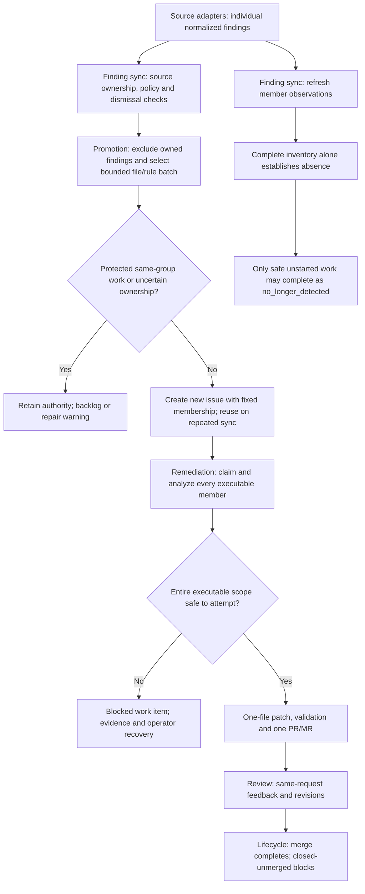

# Functional Design: Promotion-Time File/Rule Batching

## Status

**Reviewed contract; internal implementation only, not enabled in production.**
Current production work items still represent individual findings. Slices 1 through
3 supply internal planning, projection, execution, and recovery. The ten-member
default does not activate batching; production integration and operator rollout
remain slice 4.
The [technical contract](../technical/technical-design-remediation-batching.md)
specifies schema, persistence sequencing, and implementation boundaries for
the internal implementation and remaining rollout. Neither document claims
production activation or release readiness.

The [file-grouping design](functional-design-finding-file-grouping.md) is
background, not a prerequisite. This proposal assembles executable batches at
promotion without adding a persistent grouping stage to source ingestion.

## Goal And Boundaries

Reduce the number of provider work-item issues and remediation PRs/MRs for
repeated diagnostics, while keeping each change small and reviewable.

For example, five Ruff `F401` findings in `src/task_api/routes.py` can become
one work item and one one-file change request rather than five of each.

- Individual normalized findings retain their identity and provenance.
- One promoted batch is one finite work item and one successful PR/MR.
- Every batch edits only its original file; multiple edits in that file are
  permitted under the existing patch-safety rules.
- Migration or consolidation of existing issues, goal tracking, cross-file
  edits, ongoing rule buckets, semantic clustering,
  severity-specific batch limits, and multiple successful requests per work
  item are outside this proposal.
- Existing recovery may retain historical failed or closed-unmerged attempts;
  same-request review revisions do not create a second successful request.

## Promotion And Membership

### Eligibility And Grouping

Source adapters continue producing individual normalized findings. Finding
sync evaluates source ownership, promotion policy, and dismissal suppression
for each finding before considering it for a batch.

The grouping key is repository scope, canonical repository-relative file path,
stable source ID, and diagnostic rule ID. The rule ID is the scanner rule, such
as `F401`, not an occurrence ID containing a line number. Equal rule names from
different sources do not combine.

Members must have compatible remediation categories and constraints. Grouping
does not establish semantic equivalence or authorize an edit. All member
constraints, acceptance criteria, and validation requirements remain available
to execution; none may be dropped by choosing a representative member.
Compatibility is conservative: normalized categories and complete requirement
sets must match; differing requirements are not combined by inference.
Conflicting requirements must not be silently merged. Findings lacking enough
evidence to group safely retain single-finding handling.

### Size, Ranking, And Capacity

The proposed default is at most ten findings per work item. Operators can set
one positive maximum; a value of one disables multi-finding batching.
No per-severity limits are introduced. An exact
configuration spelling and validation bounds belong to the technical design.

Batch planning preserves configured source priority before severity. The
highest eligible member severity determines batch priority. Ties use stable
group and finding identities, with deterministic member selection independent
of source response order. Larger batches receive no priority bonus.

One batch consumes one slot under `remediation.max_active_work_items`, not one
slot per member. Only one active batch may exist for a file/rule group. If
twenty-three findings qualify and the limit is ten, one batch is promoted;
the other thirteen remain backlog until that batch becomes terminal and normal
promotion policy permits another batch. New overflow findings create no
provider issues solely to represent backlog.

Protected same-group work prevents new batch promotion even when it does not
consume ordinary active capacity, as with blocked work. Existing protected
duplicates remain intact; this design does not forcibly merge active work.
Unrelated groups continue competing for the remaining repository capacity.

### Stable Scope

A batch receives a durable work-item identity independent of its latest
observations. Membership freezes at promotion. A later sync may refresh member
evidence but cannot add members, replenish disappeared members, or recompute
work-item identity from the latest member set.

Each new batch receives an immutable identity without a predecessor link.
Current group/member ownership prevents overlapping work; no chain of historical
batches is required. Merge is the normal release of group ownership, but not
the only one: completion as `no_longer_detected` also permits later eligible
work. Dismissal releases the group while continuing to suppress that batch's
exact members. Open candidate/approved work and deferred, blocked, executing,
or review-feedback batches retain ownership. Manually closing a safe unstarted
batch issue releases its ownership without suppressing its findings; later sync
may create a replacement under normal policy and capacity. Safe unstarted means
unclaimed candidate/approved work with no linked request or execution, recovery,
publication-retry, or review history. Closing protected work does not release
ownership or cancel its request. Closing a request without merge follows existing
recovery rather than permitting automatic replacement. Issue closure itself
does not claim completion, successful remediation, or dismissal.

Every member retains its finding ID, source, rule, original location, severity,
diagnostic, provenance, and remediation constraints. Group membership is not
deduplication. A finding must not be executable through two authoritative work
items at the same time.

## Existing Work And New Batches

Batching applies only when promoting findings that are not already owned by
existing authoritative work. It creates a new work-item issue; it never expands
an existing single-finding issue, transfers members, closes absorbed issues,
or introduces supersession history.

Existing single-finding issues continue through their current policy,
capacity, remediation, recovery, review, and lifecycle paths. Their IDs,
membership, links, operator decisions, and execution evidence remain intact.
This does not exempt them from normal reconciliation; it means batching itself
does not migrate or consolidate them. Already frozen batches cannot absorb
more members either.

Exclude findings owned by existing work before selecting a new batch. Preserve
existing dismissal and terminal-state handling; grouping must not bypass them
by assigning the same finding a different work-item identity. Started, claimed,
linked, blocked, and review-feedback work remains protected. Existing approved
and in-progress issues continue consuming their normal capacity slots.

For example, three approved single-finding issues remain three issues and
retain their capacity usage. Do not convert them into one batch to free slots.
Active or protected same-group work prevents a new batch for that group;
eligible unowned findings wait in backlog rather than duplicating its work.
Existing protected duplicates are retained, not forcibly merged.

Operators may choose provider-native deletion of old unstarted, unlinked
issues if they want those findings reconsidered for a new batch. This is
optional manual cleanup, not an application migration or recovery command.
Deletion loses issue history and machine-state evidence; preserve any needed
records first. Deleting started or linked work can lose ownership of an active
request and is not a supported shortcut around its existing lifecycle.

On a subsequent sync, findings with no remaining authoritative owner may enter
a new batch only if still reported, policy-eligible, unsuppressed, and selected
within capacity. Deletion does not guarantee immediate promotion. Existing
single-finding issues retain their current lifecycle. For new batch issues,
closing safe unstarted work permits reconsideration without suppression; dismissing
suppresses its members, while closing protected work retains ownership. None of
these actions should be presented as a successful remediation.

Recheck relevant ownership and protected work before creating a batch. If it
changed or is ambiguous, preserve current authority rather than create duplicate
executable work. Repeated syncs must reuse an already created batch, including
after a provider response or projection failure. Preserve bounded warnings and
stop where authority is uncertain. Labels remain discovery indexes, not proof
of membership. The technical design must describe discovery, idempotency, and
existing read-before-write limits; CI scheduling alone is insufficient.

If an operator reopens an old issue after a replacement batch was created,
the normal ownership check must detect conflicting same-group work or overlapping
members. Skip ambiguous new pickup and log a warning; the operator closes the
redundant safe unstarted issue. Do not cancel existing execution, merge batches,
or introduce a dedicated reopening workflow, new status, or automatic repair.

## Member Observations And Reconciliation

Frozen membership and current observations are separate. An observation may
establish that a member remains detected, is no longer detected, is excluded
by current policy, or has unknown freshness because its source is unavailable.
Detected counts include any currently detected policy-excluded members; the
excluded count is a subset, not an additional set of findings.

Track last confirmed presence separately from evidence freshness. If a complete
scan confirms a member absent and the next scan fails, retain its confirmed
absence and mark the evidence stale/unknown; do not put it back into execution.
Only a later authoritative detection can restore that member. Likewise, failure
does not remove a previously detected member. Display stale counts as last known,
not fresh inventory results; unavailable scans cannot establish new absence-based
completion.

Policy filtering happens before batch creation: findings already excluded by
rule or severity never enter a new batch. For existing batches, the primary
operator flow is whole-batch policy deferral and reactivation. Disabling the
shared rule excludes all members; disabling their shared severity normally
has the same effect. Safe unstarted work becomes `policy_deferred`, not fixed
or completed. Re-enabling policy reactivates the same frozen batch when
capacity permits; if capacity is unavailable, it remains closed as
`capacity_deferred` rather than being replaced by a new batch.

Per-member eligibility remains the underlying contract. A rule is not guaranteed
to have one severity: source metadata and artifact-local severity mappings may
differ, and future policy may become more granular. Mixed eligibility is an
edge case, not the primary operator workflow or a new partial-success mechanism.

| Situation | Safe unstarted batch behavior |
| --- | --- |
| All members remain detected and eligible | Retain the batch and its frozen scope. |
| One member is absent from a complete managed inventory | Record absence; retain the batch and target remaining eligible members. |
| All members are absent from a complete managed inventory | Complete as `no_longer_detected` without generating an edit. |
| Some detected members become policy-ineligible | Preserve membership, exclude those members from the executable scope, and show the narrower scope. |
| None are eligible but some remain detected | Apply `policy_deferred`, not completion. |
| Eligible deferred work lacks capacity | Keep the existing capacity-deferral behavior; do not open a backlog-only issue. |
| Inventory is incomplete, unavailable, or unmanaged | Do not infer absence or claim a fresh count; preserve authority and identify unavailable evidence. |
| New compatible findings appear after promotion | Keep them outside the frozen batch for later promotion. |

If refreshed evidence contradicts the frozen source/file/rule scope or remaining
executable members have incompatible requirements, finding sync blocks otherwise
safe unstarted existing work with bounded selection evidence. Persist the blocked
state before reopening a deferred issue so the operator can see the cause. This
is a selection problem, not an execution failure. Observation changes never
automatically unblock it; explicit operator recovery is required. Findings with
no durable issue remain backlog-only and do not get notification issues.

The projection and slice 3 execution/recovery implementation remain internal;
production batch creation and intake stay disabled until slice 4.

If policy later permits an original member again before execution, that member
may rejoin the executable scope without changing frozen membership. Re-enabling
work still respects capacity and protection rules. Linked or started work
retains the existing protected lifecycle; finding sync does not independently
cancel its MR/PR or rewrite its execution result.

Execution uses the latest recorded observations. This design does not require
remediation to fetch scanner artifacts or run a new intake workflow itself.
Unknown evidence is never converted to absence to manufacture a smaller batch.

For example, a batch starts with five members. Before pickup, a developer
resolves two and a complete managed source scan no longer reports their exact
identities. Preserve the five-member history, mark those two no longer detected,
and analyze and remediate the remaining three eligible members in one MR/PR.
This is normal scope narrowing, not a blocked or partially failed batch. If
all five are confirmed absent before execution, safely complete the unstarted
work item as `no_longer_detected` without publishing a request.

Failure to locate a diagnostic in a source snippet, or an analysis claim that
it was already fixed, does not establish absence. Without authoritative scan
evidence, retain the member rather than silently remove it. If that uncertainty
prevents safe execution, expose the evidence problem instead of presenting a
smaller batch as fully accounted for.

SARIF identity remains location-bound. An unrelated edit can move a diagnostic,
causing the prior occurrence to become absent and a newly located occurrence to
enter backlog. This behavior can also make every original batch member absent;
it is not proof that the underlying problem was fixed. Relocation matching is
out of scope, and the UI must use the existing truthful `no_longer_detected`
resolution rather than imply successful remediation.

## Execution, Review, And Completion

Analysis and structured-edit generation receive the explicit remaining eligible
members, their shared file, and all applicable member requirements as bounded,
untrusted evidence. The same file remains the sole editable target, including
validation-feedback retries and operator-authorized review revisions.

Analysis must account for every member in the executable scope. A source rule
is evidence, not an instruction or proof that its fix is safe. The existing
semantic-safety mechanism validates the shape of the analysis claim, not its
truth or actual resolution of every diagnostic.

No partial batch is published. If analysis cannot safely address all remaining
eligible members, block the batch with a compact reason and the affected member
references. Context limits cannot silently discard members; inability to supply
the required evidence also stops execution. This does not create an automatic
split, partial-success path, or second successful MR for the work item.
All-or-nothing applies to the current executable scope, not every original
member regardless of its latest confirmed observation.

Members already absent or policy-excluded before execution are not failed
partial fixes: they are explicitly outside the current executable scope.
Execution and publication failures retain existing rollback and bounded failure
evidence. Operators use existing recovery or dismissal on the authoritative
work-item issue. Dismissing a batch suppresses its
member identities; it must not suppress every future finding for that rule/file.

A blocked batch does not automatically become executable when a later scan
confirms that its problematic member is no longer detected. Finding sync may
refresh member observations, but preserves the blocked state and failure
evidence. The operator must explicitly issue `/zeroone remediation requeue` on
the authoritative work-item issue, subject to existing recovery eligibility and
authorization rules. After accepted requeue for a fresh attempt, remediation
reassesses the remaining policy-eligible original members; it does not restore
absent members or expand the frozen batch. Select the existing recovery mode
first: a publication retry verifies and publishes its recorded commit and attempt
scope rather than reassessing members. Even if all members become absent while blocked, scan updates
alone do not unblock or complete it; existing recovery and lifecycle ownership
remain authoritative.

Confirmed absence may complete all-absent work without an edit only in fresh
recovery, not while retrying publication of an existing commit. Failed verification
of that recorded commit leaves the work blocked with evidence; do not silently
switch recovery modes or claim successful completion.

Review feedback remains attached to the same linked request and original file.
Closed-unmerged requests follow existing blocked-work and fresh-attempt recovery
behavior, preserving batch membership and prior request evidence.

Merge completes the work item through lifecycle reconciliation. There is no
post-merge scanner-completion gate or goal-progress lifecycle. A merged batch
stays closed if later intake reports remaining or newly located findings;
those reports follow intake policy rather than extending the completed batch.
Historical membership alone is not permanent suppression. In the mixed-policy
edge case, a member excluded from the published edit may be reconsidered for a
new batch if later authoritative evidence still reports it and policy permits
it. This does not bypass explicit dismissal suppression or reopen the completed
batch.
Batching uses the existing scan-before-sync pipeline contract: scan the trusted
target branch, sync that pipeline's findings, then run remediation. Later runs
must scan the updated branch before promoting more work; the target-branch
setting alone does not make an old report current. Failed scanners must not be
replaced with cached reports or manufactured empty inventories. This proposal
adds no runtime revision-verification or post-merge freshness gate; stale input
from incorrect pipeline wiring remains an explicit operational limitation.

## Operator Experience

Titles are concise and file/rule-specific. A friendly title may say
`Remove 5 unused imports in routes.py`; its count describes original membership,
not a promise that five fixes were verified. Unknown rules use neutral wording
rather than an invented diagnosis.
The neutral title format is `ZeroOne Ops: F401 - 5 findings in routes.py`.
Keep the original count stable as observations change; show the current targeted
count in the body rather than renaming the issue on every sync.

The issue leads with state, priority, shared source/rule/file, scope counts, and
the next operator action. Detailed diagnostics and provenance remain available
without dominating the overview. Counts are explicitly tied to the latest
authoritative inventory, not presented as a live progress estimate.

Show a short, state-aware closing explanation alongside existing policy/block
and dismissal guidance, before the collapsed machine state. For safe unstarted
batch issues: "Closing this issue does not suppress its findings. If they are
still reported and eligible, a later sync may create a new work item, subject to
available capacity." For protected batches: "Closing this issue does not cancel
the linked request or stop this remediation. Use the applicable recovery or
policy instructions below." Where no linked request exists, omit that reference.
Use existing policy guidance for future promotion exclusions; do not invent a
block command. Render dismissal/requeue commands only where the existing command
contract supports them, not on every candidate or approved issue.

Use a task-first layout: short scope explanation, status and next action,
compact scope counts, and a bounded table with meaningful finding messages.
Place linked-request, validation, and semantic-safety evidence below this
overview. Collapse full diagnostics/provenance and machine state, not the next
action or failure summary. Stable member IDs remain in detailed evidence, not
the primary table in place of useful messages.

Illustrative issue body after two members disappeared before pickup, with policy
still enabled for the remaining members:

```markdown
This work item targets unused imports in one file.
Membership is fixed; newly discovered findings wait for a later batch.

## Status

- Status: approved
- Priority: medium
- Source / rule: Ruff SARIF / F401
- File: src/task_api/routes.py
- Next action: Await remediation pickup.

## Scope

5 original findings | 3 currently targeted | 2 no longer detected

Observations: latest complete finding sync, run <sync-run-id>.
"Targeted" describes the current planned scope, not verified fixes.

| Original line | Finding | Current scope |
| --- | --- | --- |
| 3 | Unused import: os | Targeted |
| 12 | Unused import: sys | Targeted |
| 18 | Unused import: json | Targeted |
| 24 | Unused import: pathlib | No longer detected |
| 31 | Unused import: typing | No longer detected |

## Operator Guidance

Closing this unstarted issue does not suppress its findings.
Still-reported eligible findings may return in a new work item, subject to
available capacity.

<details>
<summary>Finding details and provenance</summary>

Full per-member diagnostics, stable IDs, and source evidence.

</details>

<details>
<summary>Machine State</summary>

Authoritative state managed by ZeroOne Ops.

</details>
```

After pickup, show execution in progress until a request is linked; then direct
the operator to review that PR/MR. Blocked and review-feedback states show the
failure or feedback summary and applicable existing commands. Deferred work
explains policy or capacity instead of promising immediate pickup. Show unknown
freshness and policy exclusions in scope counts when applicable. Do not display
validation success before a recorded execution result exists.

Retain existing Last Execution, workflow-log link, review projection, and
semantic-safety evidence where applicable. Safety evidence must describe the
actual executable scope. Member lists and descriptions remain bounded, with an
explicit indication of omitted display details; machine authority must retain
all members. Existing single-finding issues retain their own history and command
guidance; batch creation does not redirect or rewrite them.

Distinguish targeted findings, no-longer-detected observations, validation
outcomes, and merged changes. Publication or merge alone must not produce a
claim that the scanner verified every member fixed. GitHub and GitLab provide
equivalent evidence and command guidance, using provider-native links and names.

## Ownership Flow



Finding sync owns inventory, batch planning, and policy/capacity projection.
Remediation owns execution and request publication. Review owns review evidence
and existing revision decisions. Lifecycle owns native request terminal
reconciliation and projection repair, not scanner absence or batch assembly.
Providers own transport and derived issue/label rendering; machine state owns
authority.

## Acceptance And Review Scenarios

| Scenario | Required outcome |
| --- | --- |
| Five compatible findings in one file | One work item, one capacity slot, one one-file MR/PR. |
| Default limit with twenty-three findings | Ten promoted; thirteen remain backlog while the first batch is active. |
| Limit one | No multi-member work item. |
| Different source, rule, file, or incompatible requirements | Do not combine across the boundary; preserve individual evidence. |
| Equivalent inventory in a different order | Same group/member selection and reuse decision. |
| Mixed member severities | Policy filters members first; highest included severity ranks the batch after source priority. |
| A dismissed member and nine eligible members | Suppress only the dismissed identity before batching. |
| Three existing approved single-finding issues | Preserve all three issues, their capacity usage, identities, and history; do not consolidate. |
| New eligible findings not owned by existing work | Create one new batch when group protection and capacity permit. |
| Claimed, linked, blocked, or review-feedback same-group work | Preserve it and its evidence; do not start a conflicting batch. |
| Repeated sync or failed batch-create response | Rediscover and reuse authority or report uncertainty; never duplicate executable ownership. |
| Old issue reopened after replacement creation | Detect conflicting ownership, skip ambiguous new pickup, and log a warning; operator closes the redundant safe unstarted issue. |
| Previous batch merged or completed as no_longer_detected | After authoritative completion, allow a later eligible batch with a new identity and no predecessor link. |
| Previous batch dismissed | Keep its exact members suppressed; other eligible members may form a new batch in the same group. |
| Previous batch deferred or its request closed without merging | Retain nonterminal ownership and existing reactivation/recovery; do not create a replacement. |
| Concurrent claim or ownership change before creation | Recheck; preserve existing authority and stop conflicting promotion. |
| Operator deletes an old unstarted, unlinked issue | Reconsider still-reported unowned members on a later sync under normal eligibility and capacity rules; do not guarantee promotion. |
| Safe unstarted batch issue manually closed | Release ownership without suppression; still-reported findings may form a new batch under normal policy and capacity. Show that consequence before closure. |
| Protected batch issue manually closed | Preserve ownership and linked execution; do not create a replacement or claim dismissal. Show applicable recovery guidance. |
| Blocked batch dismissed with the supported command | Suppress its exact members, distinguishing dismissal from ordinary issue closure. |
| One or all original members absent in safe unstarted work | Retain remaining work, or safely complete all-absent work as no_longer_detected. |
| Two of five members resolved by a developer and absent from a complete scan before pickup | Keep five-member history; analyze three remaining eligible findings and publish one request, without blocking for the two absent members. |
| Analysis cannot locate a finding, with no scan-confirmed absence | Do not drop it based on the snippet or model claim; report an evidence problem if safe execution cannot continue. |
| Missing artifact, failed scan, or incomplete inventory | Preserve observations without treating unavailable evidence as absence. |
| Confirmed-absent member followed by scanner failure | Keep the member absent and excluded from execution, mark freshness unknown, and restore it only after a later authoritative detection. |
| All remaining members excluded by policy | Defer rather than claim completion; reactivation respects capacity. |
| Shared rule or shared severity disabled, then enabled | Defer the safe unstarted batch; reactivate the same frozen batch within capacity, without creating a replacement. |
| Mixed-policy member excluded from an edit, then enabled after merge | Historical membership does not suppress it; later authoritative intake may select a new batch while the completed batch stays closed. |
| Diagnostic moves to a different line | Preserve location-bound semantics and explain possible new-occurrence churn. |
| One executable member cannot be safely fixed or context exceeds bounds | Block the batch; publish no subset and omit no member silently. |
| Problematic member disappears from a complete inventory after the batch is blocked | Refresh observations and retain blocked state and failure evidence; require explicit operator requeue before reassessing the remaining executable scope. |
| All members disappear while the batch is blocked | Do not automatically unblock or complete it; preserve recovery and lifecycle ownership. |
| All members disappear before an operator-authorized publication retry | Keep the recorded attempt scope and verify/publish its commit; do not apply fresh-attempt all-absent completion. Verification failure remains blocked. |
| Patch or validation failure | Existing rollback and failure evidence; no partial publication. |
| Review findings or closed-unmerged request | Existing operator-controlled revision/recovery, same file and frozen membership. |
| Request merged | Lifecycle completes the batch without claiming scanner-verified fixes or waiting for a new completion phase. |

Before implementation, review provider parity, new-batch ownership and terminal
ownership, bounded evidence, and unavailable-source behavior. A technical design
must make these requirements implementable without relying on pipeline timing.
No production code, configuration default, persisted schema, command, or release
gate changes are made by publishing this functional proposal.
