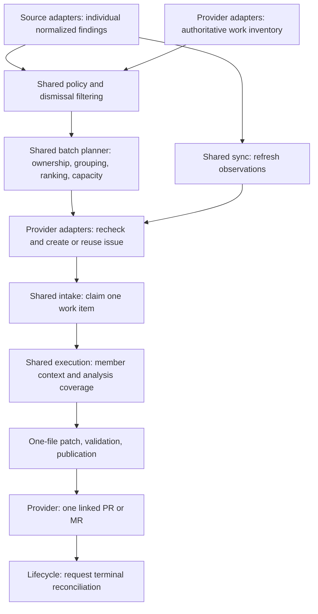
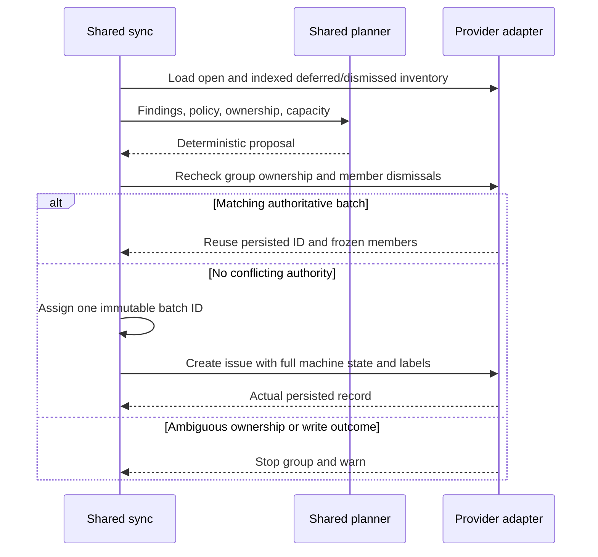

# Technical Design: Promotion-Time File/Rule Batching

## Status And Ownership

**Proposed for review; not implemented.** This document specifies the
[functional batching contract](../functional/functional-design-remediation-batching.md).
Interfaces below are proposed additions, not current runtime guarantees.
Implementation and release placement require separate approval. The
[file-grouping design](technical-design-finding-file-grouping.md) is optional
background, not an ingestion prerequisite.

Extend `FindingSyncCoordinator`, its workflow-specific `FindingSyncStorage`
adapters, and the shared execution path. Do not add provider-specific batching
loops. Current identity, capacity, execution adapters, and context contracts
assume one finding; a batch cannot be an arbitrary representative finding with
a different title.



Finding sync owns observations and safe unstarted projections; remediation owns
execution and outcomes; recovery authorizes retries; lifecycle owns linked-request
terminal state. Providers own discovery, authorization, transport, projection,
and request lookup. Git operations remain in focused Git services. Runner/CLI
composition, individual ingestion, and one-file patch safety remain intact.

## Configuration And State Contracts

Propose `remediation.max_findings_per_work_item: int = 10`, strictly positive,
rejecting booleans and non-integer coercion. No new numeric ceiling is introduced;
execution budgets remain hard limits. `1` uses single-finding handling for new
work. Configuration changes never resize existing batches.

Add optional `batch` state to `WorkItemState`, absent by default. Historical
singles continue decoding, rendering, and executing under their current contracts.
Never infer membership from titles or descriptions. Illustrative interfaces:

```python
class FindingBatchGroup(BaseModel):
    repository_scope: str
    file_path: str
    source_id: str
    rule_id: str


class BatchMemberObservation(BaseModel):
    finding_id: str
    last_confirmed_presence: Literal["detected", "absent"]
    freshness: Literal["current", "unknown"]
    sync_run_id: str
    observed_at: datetime
    last_confirmed_sync_run_id: str | None = None
    last_confirmed_finding: NormalizedFinding | None = None


class WorkItemBatch(BaseModel):
    schema_version: Literal[1] = 1
    group: FindingBatchGroup
    members: tuple[NormalizedFinding, ...]
    observations: tuple[BatchMemberObservation, ...]


class BatchUnaddressableMember(BaseModel):
    finding_id: str
    explanation: str = Field(min_length=1, max_length=600)


class BatchAnalysisCoverage(BaseModel):
    addressed_member_ids: list[str]
    unaddressable_members: list[BatchUnaddressableMember]
```

Require nonempty unique members, exactly one observation per member, and shared
source/path/rule matching the group. Preserve full original normalized member
snapshots, including provenance and requirements. Observations refresh evidence
for the same exact identity; they never rewrite or replenish original membership.
Keep only the latest freshness observation and last confirmed presence/evidence
per member, alongside its frozen original snapshot. Initialize promoted members
as detected. A reported detection updates confirmed presence, finding evidence,
and confirmation run. Complete managed inventory absence updates confirmed
presence to absent and advances the confirmation run, retaining the last detected
finding for history. Both confirmations set freshness to current.

An incomplete/unavailable/unmanaged inventory that cannot confirm a member marks
freshness unknown, without changing its confirmed presence, evidence, or
confirmation run. A previously absent member therefore remains outside execution
until a later authoritative detection restores it. Previously detected members
remain subject to normal eligibility and bounded-evidence checks; scanner failure
neither drops them nor restores absent members. Latest sync run/time identify the
freshness assessment, while the confirmation reference identifies its evidence.

Derive policy eligibility from the current policy and last confirmed finding,
falling back to the original snapshot. Derive counts and the executable subset
from those decisions and observations; do not persist parallel eligibility flags,
counts, or a mutable executable-member list on the batch. Mark unknown freshness
explicitly. Persist exact targeted member IDs only as execution-attempt evidence,
where publication retries and review continuity need a historical scope.

The work-item ID is the durable batch ID. Its source reference uses the canonical
source ID and reserved `batch-v1:<uuid>` item key; member finding IDs remain
unchanged. Top-level file, rule, source, severity, and summary describe the batch,
not a representative member. Validate consistency with nested state on parsing.

Example observation projection for a frozen batch, omitting full member objects:

| Original member | Last confirmed presence | Freshness | Policy | Attempt scope |
| --- | --- | --- | --- | --- |
| A | detected | current | eligible | targeted |
| B | absent from complete inventory | current | eligible | excluded as absent |
| C | detected | current | excluded | excluded by policy |

Original count is three, detected two, absent one, policy-excluded one (a subset
of detected), executable one. Persist run/time references for these observations.

## Compatibility, Identity, And Capacity

The grouping key is repository scope, canonical repository-relative path, stable
source ID, and diagnostic rule ID. Do not case-fold paths or infer a rule from
an occurrence ID. Missing grouping evidence retains single-finding handling,
subject to existing eligibility checks.

Normalize category aliases using the existing helper. Compatible requirements
mean equal category, expected change, constraints, validation commands, and
acceptance criteria. Preserve command order and exact text; compare acceptance
criteria as sorted unique strings without rewriting contents. Empty/missing lists
are equivalent; absent and nonempty text are not. Differing signatures within an
eligible unowned group fall back to singles, not semantic requirement merging.
Only one new unit for that group may be selected in a pass.

Shared planning proceeds without writes:

1. Apply individual policy and exact dismissal suppression.
2. Expand batch members and existing single identities into one ownership index;
   ambiguous ownership stops conflicting selection.
3. Preserve active approved/in-progress/review-feedback capacity consumers and
   same-group protected work, including claims, links, and blocked work. Deferred
   durable batches compete as frozen units, not as new member proposals.
4. Sort unowned compatible members by severity then stable source/finding ID;
   take at most the configured limit. Overflow stays non-durable backlog.
5. Rank candidate units by source priority (default `100`), highest currently
   executable severity, canonical group key, then stable member identity. Larger
   units receive no bonus. Count one durable/new unit per capacity slot.
6. Preserve capacity-deferral behavior for durable losers; create no issues for
   unselected new units. A nonterminal batch reserves its group until terminal.

Existing issues are never absorbed, superseded, resized, or closed by batching.
Approved singles retain separate capacity usage; deferred singles retain member
ownership. Existing protected duplicates remain intact but stop conflicting new
promotion. Dismissal suppresses exact original member identities, not the group
forever. Completed batches do not indefinitely own future findings.

Assign a UUID4 once when a new batch is selected for creation. Use its hex value
in the `work-<uuid>` work-item ID and `batch-v1:<uuid>` source item key. Retain
that ID across retries of the same creation operation; once persisted, reuse
the provider's authoritative ID and membership. Observation changes, recovery,
and review revisions never generate a replacement ID for the same work item.

No predecessor field, generation chain, or terminal-history lookup is required
to assign identity. Authoritative group/member ownership, not lineage, controls
whether new work may be created. Multiple nonterminal owners are ambiguity;
preserve existing authority rather than select one arbitrarily.

| Previous same-group work | New batch behavior |
| --- | --- |
| Open candidate/approved work, or executing, claimed, deferred, or review-feedback work | Retain group ownership; no new batch. |
| Manually closed safe unstarted candidate/approved batch | Release ownership without suppression; still-reported eligible findings may be selected again. |
| Blocked, including a request closed without merge | Retain ownership and use existing explicit recovery; no automatic replacement. |
| Completed after merge or as `no_longer_detected` | Release group ownership; a later scan may promote eligible unowned findings. |
| Dismissed | Release group ownership, but suppress its exact members through the existing dismissal inventory. Other eligible members may form a new batch. |

Safe unstarted batch work means unclaimed candidate/approved state with no linked
request or execution, recovery, publication-retry, or review history. Native issue
closure releases only this narrowly defined ownership; it does not manufacture a
terminal machine-state resolution. Protected closed work retains ownership. A
merged request releases its group only after existing lifecycle reconciliation
records completion. Preserve historical single-finding ownership rules and
protected duplicates without migrating them into batches.

## Discovery And Creation Protocol

Retain current open and narrow deferred/dismissed inventories and their complete
pagination. Expand parsed batch members into the shared ownership and suppression
indexes. No general closed-batch history scan is needed for planning or identity.
Incomplete/failed ownership discovery stops affected creation rather than being
treated as an empty inventory.

Add narrow label-filtered closed nonterminal batch discovery to distinguish
manually closed safe unstarted work from protected closed work. Query the existing
candidate/approved/in-progress/blocked/review-feedback status indexes, verifying
parsed state; deferred work is already indexed. Release only safe unstarted
batch ownership and retain protected records in the shared ownership index. Do
not infer protection or suppression from provider closure alone. These reads are
not terminal predecessor-history queries and apply equally in dry runs.
Exclude released manually closed batches from automatic reactivation and intake;
status repair must not reopen them as an alternative to creating new eligible
work. Keep their issue bodies as history without assigning a false completion
or dismissal resolution. Re-read native closure and machine state before acting
on a release decision, just as other ownership changes require rechecks.

Extend the narrow storage boundary with typed group-ownership reads and targeted
batch-ID rediscovery for uncertain writes. Use a derived `zeroone-batch:<uuid>`
label alongside the work-item label for exact-ID lookup across open and closed
issues; verify its parsed machine-state ID and membership. Labels remain indexes,
not proof. Keep native issue snapshots local. Immediately before creation, refresh
open/deferred group ownership and member dismissals, including overlap with
singles. Upsert checks batch identity and member overlap, not just its synthetic
source key. Reuse unique persisted batches without recomputing membership.



After an uncertain create response, search the assigned batch ID across issue
states and refresh group/member ownership before any further creation attempt.
Reuse a unique authoritative match, including its actual persisted membership.
If no match establishes the outcome, stop that group for the run rather than
blindly retrying, even after a successful empty search. A subsequent sync must
rediscover current ownership before selecting new work, not simply regenerate
the failed proposal's ID and resend it. Intake also rejects duplicate membership.
Preflight reads and creation are not atomic; concurrent writers can still race.
No provider CAS, reservation, or exactly-once guarantee is claimed.

Reopening an old issue after replacement creation is covered by the shared
ownership check: conflicting same-group work or member overlap excludes ambiguous
new pickup and emits a bounded warning with issue references. Preserve existing
execution and let the operator close the redundant safe unstarted issue. No
reopening-specific workflow, persisted status, or automatic repair is required.
Add one regression scenario proving reopened conflicting work cannot start
another execution and produces the warning.

## Observation Reconciliation And Freshness

Match members by exact source/finding identity within repository scope. Reported
members are detected; absence requires a complete managed inventory for that
source. Incomplete/unavailable/unmanaged inventories cannot establish absence.
They also cannot reverse previously confirmed absence: retain that presence and
mark freshness unknown. Unavailable syncs do not introduce new absence-based
terminal transitions. Only a later reported detection can restore an absent
member to the potential executable scope.
Location movement remains old-absent/new-occurrence, not relocation matching.

For safe unstarted work: all absent takes precedence and completes as
`no_longer_detected`; otherwise no remaining eligible members means policy
deferral; otherwise capacity selects approved or capacity deferred. Re-enable the
same frozen batch, never replace it. Use existing guarded update-before-close
and reopen-before-active-update ordering, authoritative re-reads, and warnings.

Blocked, claimed, linked, and review-feedback states are not safe unstarted work.
Refresh observations while preserving status, claim, failure evidence, review,
and linkage. Even all-absent blocked work remains blocked. After accepted operator
requeue, select the existing recovery mode before reassessing member scope.
Publication retry retains the recorded commit and targeted members; refreshed
absence does not convert it into all-absent completion. Only fresh-attempt
recovery reassesses remaining original members. If all are then confirmed absent
and no linked-request lifecycle takes precedence, complete without a model call
or request. Recovery must permit that authorized reassessment rather than
reject it solely because no promotable finding remains. Existing authorization,
replay, and linked-request rules still apply.

### Existing Scan-Before-Sync Contract

Batching inherits the same pipeline contract as single-finding work: scan the
trusted target branch, consume that pipeline's reports in finding sync, then
run the control plane. A later pipeline scans the updated target branch after
merge before promoting further work. The target-branch setting alone does not
refresh a report or prove which checkout it describes.

SARIF producers must generate the configured reports from that pipeline's scan
checkout and wire those artifacts to sync; do not substitute a cached report
after a failed producer. For SonarQube, the pipeline must wait for its submitted
analysis to finish before collecting findings. Preserve existing scanner failure
and incomplete/unavailable-source behavior; never manufacture empty successful
inventories after failure. These are pipeline installation requirements, not
new runtime provenance checks.

Lifecycle completes merged batches immediately under existing rules. Subsequent
intake may promote overflow or previously excluded members from current reports
without reopening completed batches or bypassing dismissal. No merge checkpoints,
revision-provenance schema, ancestry verification, or freshness-specific backlog
gate is added. Batch IDs require no predecessor links or merged-batch history.

Runtime cannot independently detect every stale report supplied by a misconfigured
pipeline. Document that residual limitation instead of claiming revision-verified
freshness. Stronger provenance enforcement is separate future hardening, not a
batching prerequisite or a scanner-resolution guarantee.

## Execution Contracts And Retry Safety

Extend `RemediationExecutionTarget` and `IssueContext` with typed batch evidence:
batch ID, frozen snapshots, observation references, and exact executable member
IDs. Retain existing single fields for singles, not as batch authority. Snapshot
the executable subset after authoritative claim/recovery checks and persist it
with attempt evidence for publication retry and review continuity.

Use the existing single-snippet context contract: construct one continuous source
excerpt covering every executable member's known location, with normal surrounding
context, or include the full file when it fits existing limits. Include guidance
once. Do not introduce independently selected snippet windows or concatenate
disjoint fragments. Missing member locations require full-file context; if it
cannot fit, block. Existing file/line/character budgets apply across the packet.
Verify that bounded selection has not truncated any required member location;
if complete adequate evidence cannot fit, block before model calls. Unknown
freshness retains last confirmed evidence or the original snapshot; inability to
analyze it safely blocks rather than silently deleting the member. Revision
context still follows verified checkout.

Analysis adds `BatchAnalysisCoverage` to the existing aggregate strategy, intent,
and semantic-safety assessment. Addressable members need only their IDs; bounded
nonblank explanations are required only for unaddressable members. The two lists
must be disjoint and together exactly cover the executable identity set; reject
missing, duplicate, or foreign IDs. Any manual/unaddressable member blocks the
complete batch; do not dismiss its other members through the single-finding manual path.
Batch semantic-safety rejection also blocks. Deterministic validation checks
shape and coverage, not claim correctness or actual diagnostic resolution.

Structured edit receives every accepted member, its requirements, accounting,
and assessment in existing untrusted evidence blocks. Trusted constraints keep
the original file as sole editable scope. A model's inability to locate a member
is not authoritative absence. Multiple edits in that file are permitted under
existing patch, rollback, baseline, validation, and publication safeguards.

```mermaid
sequenceDiagram
    participant I as Shared intake
    participant E as Shared execution
    participant L as Analysis and edit model
    participant V as Patch and validation
    participant A as Provider publication
    I->>E: Claimed batch and executable scope
    E->>E: Guard, branch preparation, complete context coverage
    E->>L: All executable members as untrusted evidence
    L-->>E: Member accounting and semantic-safety claim
    E->>E: Validate coverage and structural gate
    alt Every member addressable
        E->>L: Generate complete one-file edit
        E->>V: Apply and validate
        alt Validation permits publication
            E->>A: Publish one request
        else Patch or validation failure
            E->>E: Roll back and block; publish no subset
        end
    else Missing evidence or unsafe member
        E->>E: Block with bounded member references
    end
```

Validation retries retain attempt scope and assessment. Publication retries use
committed attempt evidence and intent, never select new members. Fresh recovery
may narrow scope from new observations without resizing membership. Resolve
`retry_publication` before applying fresh-attempt all-absent completion. Verify
the recorded branch and commit using existing publication-retry controls; if
verification fails, retain blocked failure evidence rather than silently falling
back to a fresh attempt or claiming completion. Same-request
review revisions retain the published attempt scope and original file, treating
feedback as untrusted evidence. Sync cannot rewrite a linked request's mandate.
Review loads evidence through unique persisted linkage, not description parsing.
Failed revisions retain `review_feedback_required`, not dismissal.

```mermaid
sequenceDiagram
    participant O as Operator
    participant S as Finding sync
    participant R as Recovery
    participant E as Remediation
    S->>S: Refresh observations; retain blocked state and failure
    O->>R: /zeroone remediation requeue on work-item issue
    R->>R: Authorize, check replay, current state, and linkage
    R->>R: Select recovery mode and persist accepted transition
    alt Recorded publication retry
        E->>E: Verify and publish recorded commit with original attempt scope
        Note over E: Verification/publication failure stays blocked; no fresh fallback
    else Fresh attempt
        E->>E: Reassess original members from latest authority
        alt All absent and no linked lifecycle takes precedence
            E->>E: Complete no_longer_detected without edit
        else Remaining eligible members
            E->>E: Attempt complete scope or block with evidence
        end
    end
```

## Projection, Evidence Preservation, And Counters

Extend shared rendering with bounded member details and original/detected/absent/
policy-excluded/unknown/attempt-targeted counts. Tie counts to observation runs;
excluded detected members are a subset, not an additional population. Retain
provider-specific terminology and issue command routing. Descriptions distinguish
targeted findings, confirmed absence, validation, and semantic-safety claims.
Neither publication nor merge is scanner-verified resolution.
Unknown freshness can overlap detected or absent counts; show these as last
confirmed counts with their confirmation references, not a new unknown-presence
population or fresh scan result.

Follow the functional design's task-first layout: concise purpose, status and
state-derived next action, compact counts, and a bounded table of original line,
finding message, and current scope. Keep the title's original member count
stable. Derive planned targeted counts before execution; after publication use
persisted attempt IDs for the change's targeted count. Keep observation-run
references visible so neither count is mistaken for scanner-verified fixes.
Render validation/request/safety evidence below the overview when available;
collapse detailed diagnostics/provenance and machine state. Preserve current
escaping and provider body limits for all messages and paths.

Render the functional contract's concise closing explanation on both providers
alongside existing operator guidance. Compute safe-unstarted versus protected
wording using the same shared predicate as ownership selection. Closing is not
dismissal: explain possible replacement for safe work, and retained ownership for
protected work. Preserve existing command eligibility; never advertise unsupported
dismissal/requeue commands on unstarted issues. This is proposed renderer behavior,
not a change to currently shipped issue bodies.

Never truncate authoritative membership to fit a provider body. If full state
cannot fit, stop promotion with a bounded warning. Keep paths escaped and evidence
untrusted. Existing single issue bodies retain their current rendering.

Audit full-state reconstruction and omission-preserving merges: sync owns
observations, execution/recovery own attempt evidence, lifecycle owns linked-request
terminal outcomes. Preserve other owners' fields explicitly. Extend the tested merge
preservation list where required; do not assume newly added omitted fields are
automatically retained by the current merge helper.

Promotion, capacity, and transition counters use work-item units; backlog and
policy reasons use finding units. Add explicitly named selected-member and
unknown-freshness counts rather than mixing units. Dry runs read the same indexes
and source inventories and calculate the same proposal, with no writes, claims, models,
close/reopen operations, or summary publication.

## Verification And Incremental Delivery

| Test boundary | Required acceptance cases |
| --- | --- |
| Models/planner | Default ten, positive limit, limit one, frozen membership, exact requirements, deterministic source/severity ranking, immutable IDs, terminal versus nonterminal group ownership, twenty-three-to-ten overflow, one slot per unit. |
| Shared sync | Existing singles intact, owned/dismissed members excluded, protected groups, deferred reuse, derived eligibility/counts after policy changes, one/all absent, unavailable inventories, location shifts, blocked observations, authorized all-absent recovery. |
| Observation continuity | Complete scan marks a member absent, later scan failure marks only freshness unknown, member stays excluded; a later authoritative detection restores eligibility. Previously detected members remain detected-but-stale; unavailable sync introduces no new absence-based completion. |
| Pipeline contract | Scan before sync, current-pipeline artifact wiring, Sonar analysis completion before collection, no stale artifact substitution after producer failure, existing unavailable-source behavior, fresh reconsideration without reopening old issues. |
| Provider parity | Existing indexes plus closed nonterminal batch discovery, safe manual closure versus protected closure, exact-ID rediscovery across issue states, duplicates, late ownership/dismissal/closure, uncertain creation with no blind retry, persisted-ID reuse, machine-state round trips, projection order/failure isolation, dry-run zero writes. |
| Execution | One enclosing excerpt or full file, distant locations exceeding budgets, missing locations, no silent truncation, exact disjoint coverage lists, bounded unaddressable reasons, manual member, semantic rejection, rollback, no partial request, persisted attempt scope and intent through retries. |
| Review/lifecycle | Checkout before context, same-request revision, linked protection, one successful request, merge completion, closed-unmerged recovery. |
| Recovery precedence | Publication retry retains recorded commit/scope even after all members become absent; verification failure stays blocked without fresh fallback; fresh recovery alone may complete all-absent work without publication. |
| Rendering/reporting | Task-first layout, stable title count, meaningful member table, planned versus persisted attempt scope, state-derived next action, count units, unknown freshness, bounded escaped evidence, provider body overflow, truthful targeted/absent/merged wording, state-aware closing consequences, only supported commands. |

Delivery remains sequential and reviewable:

1. Add optional typed state, configuration, identity/ownership expansion, and pure
   planner tests without enabling batch publication.
2. Extend provider indexes/storage, sync observations, and projection under the
   existing scan-before-sync contract. Keep batch publication unavailable until
   execution support is complete.
3. Integrate context coverage, analysis, one-file execution, evidence persistence,
   recovery/retries, review, and rendering. Only then enable new batch creation.
4. Complete GitHub/GitLab parity, existing-single regressions, and live rollout
   validation. Document scan-before-sync requirements and stale-report limitations.

Implementation must run Ruff, formatting, architecture checks, mypy, Bandit,
and the full suite, followed by workflow boundary review. This documentation-only
slice requires local links, fenced blocks, and whitespace validation. Publishing
the design does not complete an implementation or release-gate checkbox.
