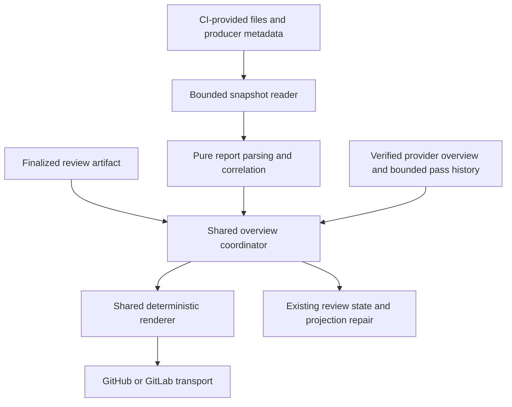

# Persistent Review Overview And Quality Evidence: Technical Design

## Status And Ownership

**Slice 1 implemented and automatically verified; live acceptance pending.** Persistent
overview publication implements the
[functional contract](../functional/functional-design-review-overview.md).
Report collection, manifest wiring, CI/JUnit/Cobertura evidence, and evidence-only
refresh remain proposed for slices 2 and 3. Aggregate checks and paired offline
scenarios verify Slice 1's implementation; live gates remain separate.
The reviewed-change summary described below is an additional proposed follow-up;
its model/output, persistence, and presentation changes are not implemented.
The reviewed-commit context UX slice is also proposed and changes presentation
metadata only, without extending model prompts or review judgment.
The [current staged-review design](technical-design-pr-review-staged-pipeline.md)
continues to own candidate/precision/overlap and inline semantics. This design's
Slice 1 publication identity and durable overview contract replace per-revision
summary identity, not those stage boundaries. Existing historical decoders remain
supported.

This design changes publication identity and adds optional quality evidence.
Candidate/precision/overlap meaning, prompt inputs, authorization, and remediation
execution remain outside its ownership.



## Current Behavior And Required Separation

Before Slice 1, `ReviewPublisher` created an authoritative summary for each new
review, published inline comments, then could update that summary with inline metadata.
Machine-safe v1 summaries support reconstruction, while `ReviewStateService`
stores bounded local review records and projection artifacts. Prior-note loading
uses native comment creation time/ID; those cannot order passes once one comment
is reused. Legacy same-SHA reuse can return a compact reference, insufficient
to regenerate a complete overview in a fresh workspace.

Keep three identities separate:

- Request identity: platform, repository scope, and PR/MR number.
- Logical review-pass identity: reviewed head plus the original completed review
  run identity, independent of comment ID and quality refreshes.
- Transport identity: overview comment ID/URL, which can be shared by many passes
  or change if an operator deletes the overview.

Do not rematch findings, reinterpret classifications, or generate prose with a
new model during rendering. Reuse the finalized artifact and validated inline
continuity decisions.

Presentation maps accepted title, location, evidence, explanation, and follow-up
into clear operator labels; it does not infer missing causes or improve prose
through another model. Anchored findings use concise overview entries and
discussion links; unanchorable findings retain bounded actionable detail in the
overview. A state-derived next action distinguishes AI concerns, independent CI
failures, and unavailable evidence without creating approval or new commands.
Tests must prove the same artifact retains its meaning with and without reports.

## Proposed UX Slice: Reviewed Commit Context

**Proposed; not implemented.** Introduce optional typed reviewed-commit metadata:
the full requested head SHA, a bounded first-line commit title, and a safe commit
URL when available. Providers fetch and normalize metadata for that exact SHA
within the reviewed repository scope. Validate that the returned full SHA equals
the requested reviewed head before attaching the metadata; never infer identity
from title text, branch names, request titles, or the local checkout.

Use at most one best-effort metadata lookup for each fresh live completed pass,
after artifact validation and before initial overview publication. Reuse response
metadata already available for the same SHA if suitable. Do not refetch changed
files, search other repositories, introduce a new operator setting, or require
broader credentials. A normal provider/transport failure or unusable response
produces a bounded warning and the SHA-only fallback, not a review failure.
Unexpected programming errors retain existing propagation behavior.

Keep lookup transport in the GitHub/GitLab review adapters and best-effort
enrichment in shared publication composition. Renderers remain pure and perform
no API calls. This slice adds no LLM calls or prompt inputs; commit messages are
repository-controlled presentation data, never instructions or review evidence.
Store only the first-line label, bounded to 300 characters with disclosed
omission, not an arbitrary multi-line commit body.

Persist optional metadata with `ReviewOverviewPass`, separately from finding and
classification authority. Retained history summaries may carry the same bounded
label/link, derived from their completed pass rather than another lookup. Missing
fields default to absent for older envelopes and local state. Preserve metadata
through inline synchronization, same-SHA reuse, fresh-workspace hydration,
projection repair, deleted-comment recreation, and future quality-only refresh.
Do not manufacture titles or issue metadata backfill reads for historical passes.

The shared renderer shows a short SHA linked to the exact full commit and a title
of at most 120 display characters, marking omissions. Use plain short SHA when a
safe link is unavailable. Move the exact head and comparison-base identifiers
into collapsed **Review Details**, while preserving their machine values and
review-pass/projection identities. Do not introduce an unverified freshness badge
or imply that a single commit title describes the entire reviewed diff.

Escape labels and validate link schemes using existing presentation rules.
Validate the complete serialized payload against the existing 60,000-byte budget
after adding metadata and collapsed details; do not resize history or truncate
authoritative evidence. Provider permissions, head/open-state guards, publication
ordering, and the separate **What Changed** proposal remain unchanged.

Implement this as one independent UX slice: normalized provider contract and
exact-SHA lookup; optional publication/history persistence; shared rendering;
then focused and paired offline tests. Cover GitHub/GitLab success, missing or
malformed metadata, wrong SHA, unavailable lookup, long/Unicode titles and marker
injection, historical decoding, repeated heads, and recovery without extra reads
or models. Verify that no title, link, or display-prefix change resets review
action timestamps, cancels a queued revision, or changes finalized findings.
Run normal repository verification and keep live presentation acceptance separate.

## Proposed Reviewed-Change Summary

**Proposed; not implemented.** Introduce a separate optional `change_summary`
contract rather than repurposing `summary`, `decision_summary`, or
`review_confidence_reason`. Those fields continue describing review outcome and
its justification. In particular, the current deterministic `no_findings`
summary must not overwrite the new description.

Use a small typed description containing one to three nonblank bullets, each at
most 300 characters, for a maximum of 900 content characters. Generate it in the
existing candidate-stage call, which already receives the bounded diff and source
context. Carry the optional description through candidate normalization and
reconciliation into `PublishableReviewArtifact` as descriptive metadata.
Precision continues owning finding retention and classification; the change
description cannot create candidates, supply missing defect evidence, or affect
confidence, remediation eligibility, or projection decisions. Do not add a
separate summarization call or a renderer-owned model dependency.

The model describes the supplied base-to-head diff. Derive scope disclosures
from existing file-selection/truncation evidence, not model assertions of full
coverage. Do not expand context budgets, follow extra links, or fetch additional
files for this feature. If the available inputs do not establish full coverage,
do not describe the section as an exhaustive account of the entire branch.

Validate description bounds during normalization. Omit unusable optional text
rather than silently truncating a factual claim or changing otherwise valid
findings; retain existing handling when the overall model response cannot be
decoded. No additional model retry is introduced to fill a missing description.
Structural validation establishes shape and bounds, not factual correctness.
Treat model-produced text as untrusted presentation evidence. Carry it as
pipeline metadata rather than adding it to precision or overlap prompt inputs;
those stages continue judging their existing evidence, not this description.

Persist the normalized field in complete provider snapshots and local recovery
artifacts, with an absent default for historical records. Summary-only history
rows remain identity/outcome summaries, not a source for reconstructing this
description. Same-SHA reuse and projection repair use stored text; a fresh review
on a new head supplies new text without mutating earlier completed snapshots.
Failed runs preserve the earlier completed artifact and description.

The deterministic renderer places **What Changed** before the verdict and uses
the existing escaping and complete 60,000-byte payload check. Include the extra
text in both retained complete snapshots when characterizing payload sizes; do
not reduce retention or truncate authority to accommodate it. Existing ownership,
discovery, publication ordering, logical identities, and provider transport remain
unchanged. No report schema, operator setting, command, or migration is added.

Implement as one bounded follow-up: model/prompt-output contract and normalization,
artifact propagation and historical defaults, then shared rendering and tests.
Keep candidate/precision/overlap call counts unchanged. Verify summary presence
for clean and findings-present outcomes, omission and bounds, scope disclosure,
injection escaping, old-payload decoding, and GitHub/GitLab persistence through
successive heads, fresh-workspace reuse, deletion recovery, and projection repair.
Offline scripts prove propagation and isolation, not summary accuracy; live review
of representative generated descriptions remains separate acceptance evidence.

## Overview Ownership And Discovery

Introduce a versioned machine envelope, distinct from the existing
`ai-sonar-bot/review-note/v1` decoder. It identifies the request, current logical
pass, retained passes, evidence revisions, and presentation version. Delimiters
are application-owned; escape interpolated values so they cannot terminate the
envelope. Visible Markdown never establishes authority.

List comments only on the exact request and paginate completely. A mutable
overview requires a structurally valid envelope matching repository/request and
an authenticated bot author matching the configured review identity. Existing
permissive machine-safe fallback may still read legacy history where currently
allowed, but does not authorize editing a comment when author lookup fails.

GitHub's provider adapter uses authenticated GraphQL viewer identity when REST
`/user` returns 403, supporting installation tokens without guessing bot identity
or changing permissions. Malformed and conflicting authority have a distinct
error boundary: they cannot fall back to cached or legacy evidence. Operational
discovery failures permit read-only reuse only; pending live projection repair
is withheld and its evidence preserved until verification succeeds.
Publication returns known authority conflicts explicitly to finalization: a
conflict detected after the first durable overview write withholds projection
and further metadata writes, retaining the completed artifact and actual inline
receipts as pending recovery evidence.

- Exactly one verified overview: re-read its current body before updating.
- None: create one after successful discovery, using verified legacy evidence
  or local artifacts where available. Do not convert or delete old summaries.
- Multiple verified overviews, malformed bot-owned overview markers, or a
  request-scope mismatch in an otherwise managed candidate: stop with a bounded
  diagnostic. Do not choose the newest and overwrite it.
- Human or foreign-bot markers: never editable and never trusted review evidence.
- Stored ID deleted: rediscover first. A confirmed missing comment can be
  replaced once; an inaccessible comment or failed lookup is not confirmed
  absence. When provider history and local evidence are both lost, do not claim
  continuity was recovered.

The entire overview body is managed. Preserve separate comments and replies, but
do not introduce operator-editable blocks inside the overview in the first slice.

### Stale Writes And Uncertain Responses

Before creating/updating, fetch current request head and current overview state.
Require the request to remain open and the pinned review head to equal its head.
Compare retained pass identity and producer-attempt metadata, not comment creation
time or file mtime.
For same-head quality updates, merge only the quality section with the currently
authoritative artifact; never replace it from an older local artifact.

An uncertain create is rediscovered by request and logical pass identity before
any further write. A unique verified match is reusable; ambiguity stops the run.
Do not blindly repeat creation. An uncertain update requires re-reading and
checking the intended pass/evidence revision rather than appending another pass.

No provider CAS is promised. A head/body change between the last read and write
remains possible; preserve CI serialization/resource groups and document this
read-before-write limitation. Do not claim timestamps alone eliminate races.

The GitHub example serializes on repository and PR number with
`cancel-in-progress: false`; it omits unscoped manual dispatch, using PR-job reruns
for retries. GitLab retains its existing review resource group. Preserve the
review-only token scope and one final-stage invocation; no report-producing
commands or second quality job are introduced by Slice 1.

## Durable Pass History And Recovery

The envelope stores the complete current finalized artifact, original run/head
identity, reviewed base/start/head diff references and diff identity, inline
references/decisions, and sufficient projection-repair evidence.
Retained completed snapshots are immutable; a quality refresh changes a separate
evidence revision, not the original artifact or review completion time.

Use separate application-owned bounds for provider storage and presentation:

- Retain complete snapshots for the current completed pass and the immediately
  preceding completed pass, including their inline and recovery metadata.
- Retain/display at most five completed pass summaries including the current
  pass. Any rows beyond the two complete snapshots are summary-only: identity,
  SHA, classification, finding counts, completion reference, and run link, never
  a fabricated artifact.
- Apply these bounds independently of `review.max_prior_review_passes`. That
  setting retains its existing local-history behavior and bounds model-context
  selection; do not turn it into a provider-storage or display setting.
- Select model evidence only from actual complete local/provider/legacy records
  under the existing selection rules. A larger requested context bound does not
  reconstruct evicted artifacts from history rows. Expose unavailable historical
  evidence rather than silently treating summary-only entries as complete passes.
- A zero local-history setting does not remove the current durable overview
  artifact. Current pending repair metadata must not be evicted by display-row
  trimming. Changing a context limit must not delete provider evidence.

These are Slice 1 application constants, not new operator configuration.
Summary-only rows cannot drive continuity matching or projection repair. Retention
is bounded, not an unlimited audit history; archived legacy comments remain
untouched. Payload-budget failure remains explicit rather than silently dropping
required complete snapshots to fit.

Use one decoded representation for provider and local state. Complete local
artifacts are a cache and can support repair, but are not the only durable copy.
A fresher verified provider pass must not be overwritten by an older local entry.
Legacy comments preserve their existing identity derivation and parsing rules;
the new decoder orders snapshots by their logical publication sequence, not the
mutable comment's original creation timestamp.

Projection refers to logical pass identity plus reviewed SHA, with transport URL
as a location only. Preserve legacy native-note references in historical decoding.
A quality refresh must not supersede queued remediation feedback or change its
action timestamp. Recovery rebuilds projection from the recorded artifact and
verified work-item linkage, not from rendered overview text.

### Publication Ordering

1. Resolve current/prior authority and the pinned head; build the finalized review.
2. Prepare the new pass and bounded envelope with projection marked pending
   before any publication write. Confirm the transport response contains the
   intended envelope and verified author, or rediscover it without repeating
   the write, including after a transport timeout.
3. Create/update the overview, then follow existing bounded inline publication.
4. Update the same pass's publication metadata with actual returned inline IDs;
   finding meaning does not change. Persist actual transport responses locally.
5. Run existing best-effort work-item projection and persist repair evidence.
   Synchronize actual inline receipts and the confirmed projection outcome into
   the managed envelope. Keep local repair pending when synchronization fails,
   even if projection itself succeeded.

An inline or follow-up metadata update failure retains existing warning behavior;
do not blindly republish inline discussions. Report when provider-backed recovery
metadata could not be synchronized and preserve local repair evidence. Fresh
workspaces cannot recover metadata that never reached durable provider storage;
the design must expose that limitation rather than inventing missing references.

`ReviewOverviewCoordinator` owns verified discovery and guarded writes;
`ReviewPublisher` retains inline transport, and `ReviewFinalizationService`
sequences projection and receipt synchronization. Continuity selects only complete
snapshots; `ReviewStateService` stores the same decoded pass model for recovery.
Deleted-comment restoration verifies the scope-bound pass identity against the
original run before using local evidence. Compact legacy references remain
readable but cannot manufacture complete recovery snapshots.

The complete serialized overview has an application budget of 60,000 UTF-8 bytes,
not a claimed provider limit. Enforce it before initial publication and subsequent
metadata updates. Apply the declared history retention first, never silently
truncate the current artifact or retained structured authority. If the payload
still exceeds the budget, fail the overview write with a bounded diagnostic;
retain the previous provider body. Do not create another comment as overflow.

Verification of the two-complete/five-summary defaults must test representative
and maximum supported finalized artifacts, inline metadata,
and pending-repair evidence against that budget. If normal supported reviews do
not fit, revisit representation/retention in design review rather than shipping
a default where old history routinely blocks new feedback. Do not silently drop
current authority or add overflow comments to hide the problem.

## Quality Input Contract

**Proposed for later slices; not implemented in Slice 1.** Quality evidence is
not collected until those slices pass their own gates. Omit the unconfigured
notice and empty quality section; render the shared AI/CI disclaimer as a footer.
Once configured, expected-report failures remain visible in **Quality Checks**,
independently of the AI verdict. The quality
interfaces, parsing, aggregation, and refresh contracts below are future work;
the bounded execution-failure notice remains part of Slice 1 publication.

Propose optional review-owned report configuration with stable report-group IDs,
literal repository-relative report paths, format (`junit` or `cobertura`), and
declared suite/shard expectations. No configured groups means no collection.
Unknown formats or invalid paths are configuration errors. No glob discovery,
provider artifact search, or new report-producing subprocesses in the first slice.

The existing CI jobs generate reports and wire them into the review workspace.
Use a versioned JSON handoff manifest with schema identifier
`zeroone/review-quality-manifest/v1`, at one explicitly configured literal path.
There is no automatic manifest discovery. Its contract contains:

- Platform, repository/request identity, expected head, and optional pinned base.
- Producer job/run IDs, source URLs, native attempt/order references, tested SHA,
  and job status; overall pipeline status is a separate optional producer record.
- Report entries with configured group, role, format, literal path, expected
  report/shard membership, and SHA-256 digest of the supplied report bytes.
- For coverage, the declared measurement scope and measurement-settings revision.
- For an optional canonical combined coverage report, the expected contributing
  report groups and their selected producer attempts, including tested SHAs and
  declared completeness. Distinguish combined coverage from stage-only coverage.

Provide supported GitHub Actions and GitLab CI examples using a maintained
manifest-generation helper invoked by the templates, not a new operator CLI
command. The helper consumes explicit configured paths and CI-supplied producer
metadata, snapshots/hashes known report bytes, and emits the versioned manifest.
It does not infer job success from XML, execute tests, or discover/download
artifacts. Operators supply paths/groups and retain their test tools; handwritten
JSON or custom generator scripts are not required for supported installations.
CI examples own explicit artifact transfer, failure-safe report publication,
producer-status handoff, and existing least-privilege/trusted-config boundaries.

Trusted CI orchestration produces the manifest separately from checked-out
application code, then passes it through workflow composition. Match its request
identity to the current trusted review context and report entries to configured
groups/paths. A digest detects mixed or replaced inputs, not producer authenticity.
Do not accept extra manifest entries as authorization to read arbitrary paths.
Do not trust XML properties or request descriptions for producer metadata.

Unknown manifest versions, missing required provenance, contradictory metadata,
or report digest mismatches withhold affected quality evidence with bounded
diagnostics. Declared expectations establish completeness; supplied file count
alone does not. Bound the manifest to 1 MiB and at most 100 report entries before
processing it. The precise configuration/wire field declarations follow this
versioned contract in slice 2, without changing report collection in slice 1.

Producer metadata is a declared CI handoff, not cryptographic attestation. The
operator owns correct artifact wiring; a local file cannot prove which job
produced it. Cross-check against CI context where available and document which
cross-job/base provenance is operator-supplied rather than independently verified.
Missing provenance withholds correlated metrics. A local/dry-run
preview can label evidence unverified, never invent a successful provider run.
Use identified producer job status, not the running review job as its own CI
result. An overall pipeline status requires a separately identified completed
pipeline; do not infer it from selected producers.

Read files through a focused snapshot reader. Resolve paths and symlinks under
the repository root, require regular files, and reject traversal/outside paths.
Snapshot bytes once so parsing and presentation use the same evidence. Do not
scan arbitrary directories. No report contents or test stdout/stderr enter model
prompts, structured logs, or the overview by default.

### Multi-Stage Artifact Handoff

Represent sequential unit and integration jobs as separate report groups, not
multiple anonymous `junit.xml` files. Explicit artifact names and repository-relative
download destinations include the group so files cannot collide. Reject duplicate
manifest destination paths rather than relying on download order to select a report.
Retain each group's native producer status and attempt; stage ordering is not
evidence that a later group ran or succeeded.

Initial combined coverage is producer-owned: an optional CI aggregation job uses
the coverage tool's raw-data merge and emits one canonical supported report.
For Python, installation guidance can demonstrate combining Coverage.py data
before XML generation. Such commands run in the existing CI producer boundary,
never in the report parser, manifest helper, or review execution path. Do not
require the application to understand every coverage tool's raw data format.

The aggregation handoff identifies all expected contributing groups/attempts and
the measured commit, scope, and settings. Structural validation cross-checks those
references against the manifest's declared producer records. It does not independently
recompute the tool's merge or prove that the aggregator used those inputs.
An aggregate file alone is insufficient proof of completeness. Missing, skipped,
canceled, digest-mismatched, or incomplete required contributions withhold complete
combined metrics and their base/head delta. A failed producer is not automatically
missing: valid complete coverage measurements may coexist with failed tests.

Select combined coverage explicitly for the overall row. Keep stage coverage
separate, and never derive overall coverage by summing/averaging stage percentages
or merging arbitrary cross-group XML reports. Without a declared combined report,
show per-group measurements and overall unavailable/not configured. Head/base
combined reports require the same expected contributor groups and measurement
scope/settings; do not compare a unit-only base against a unit-plus-integration head.

### Proposed Non-Persisted Interfaces

These sketches specify responsibilities, not executable declarations or an
already-supported configuration schema:

```text
ReportInput: group, role, format, path, expected_shards, producer_metadata
ReportSnapshot: input_identity, bytes, digest
TestEvidence: availability, counts, producer, tested_sha, completeness
CoverageEvidence: availability, scope, covered_lines, valid_lines, line_index
ReviewQualityEvidence: request/head/base identities, CI, tests, coverage, sources
ReviewOverviewState: request, transport_reference, current_pass, retained_passes,
                     quality_evidence_revision, bounded_execution_notice

snapshot(inputs) -> report snapshots or bounded availability failures
parse_junit(bytes) -> normalized cases and collection errors
parse_cobertura(bytes) -> normalized file/line measurements
correlate(parsed, producer_metadata, pinned_request) -> quality evidence
render(final_artifact, continuity, quality, history) -> deterministic body
publish_verified_overview(expected_head, expected_pass, body) -> actual response
```

Persist normalized bounded counts, identities, provenance/digests, warnings, and
quality revision metadata, not raw XML, stack traces, or whole coverage indexes.
The current line index is transient input for changed-code calculation. Optional
additive state fields must default safely when historical files are loaded.

## Parsing, Aggregation, And Comparison

Report parsers are pure and provider-neutral. Snapshot reading owns filesystem
access; provider adapters own comment/request transport and native metadata.
All report interpretation and metric calculation is deterministic, without model
calls, prompt changes, or AI root-cause analysis. Structural consistency and
commit correlation do not independently prove the producer ran the claimed tests.

### JUnit XML

- Accept supported `testsuite`/`testsuites` nesting and count leaf test cases once.
  Do not add parent aggregate counters to child counts.
- Keep passed, failed, errored, skipped, and suite-level collection errors
  separate. All-skipped or zero-case reports are not a successful test run.
- Check supplied aggregate counts against normalized cases. Summary-only reports
  claiming nonzero tests without cases are incomplete for initial support.
- Identify cases by report group, suite path, classname, name, and optional file.
  Shard provenance identifies transport, not a new test identity.
- Reject ambiguous duplicate case identities rather than summing them. The first
  slice expects reports from one selected producer attempt; do not automatically
  fold test retries or matrix runs into an invented single result.
- All declared suites/shards must arrive before combined counts are complete.
  Valid subsets may be displayed only with an explicit incomplete label.
- Distinct matrix variants use separate report groups and per-group counts.
  Do not claim a unique-test total by adding executions from different variants.
- Unit/integration totals require explicitly disjoint suite groups and no
  ambiguous duplicate cases across contributors. Otherwise show per-group counts
  without a combined test total; group labels alone do not prove disjointness.

### Cobertura XML

- Normalize source paths to repository-relative files using explicit producer
  prefix mapping where required; reject external/escaping and ambiguous paths.
- Use line coverage, not branch coverage, in the initial interface. Repeated
  file/line entries are unioned within one declared measurement scope; hits greater
  than zero mean covered, never additional covered-line occurrences.
- Validate counters against normalized line measurements. Combine only declared
  compatible shards within one group/producer attempt; do not average percentages
  or add duplicate file totals. Cross-stage combined coverage is consumed from
  the canonical CI-produced report, not assembled from independent stage reports.
- Head evidence must match the reviewed head. Base evidence must match the pinned
  review comparison base and the same report-group set, scope, and measurement
  settings. Otherwise head coverage may remain available but delta is unavailable.
- Report percentage-point delta, retaining numerator/denominator and provenance.
  Do not claim coverage improved merely because unrelated files were excluded.
- Calculate changed-code coverage from executable head lines reported in the
  pinned added/modified diff. Disclose changed files with missing measurement;
  do not classify them as fully covered or silently outside scope. A zero
  executable-line denominator is not applicable, not 100%.

Synthetic merge reports are initially unavailable for head comparison, with their
actual tested SHA and source link shown. Supporting a separately labeled merge
result later must not relabel it as head evidence. Never replace the pinned base
with the latest convenient target-branch report.

Same-SHA reuse retains the accepted review's recorded comparison base and diff.
If the target branch advances, do not silently recalculate changed-code coverage
for a different diff while claiming it belongs to that accepted pass. Show the
recorded base; mismatching inputs are unavailable. This does not introduce a new
base-change-triggered model review policy.

### Defensive Bounds

Proposed initial application bounds: 100 configured report files, 10 MiB per file,
50 MiB total input, XML nesting depth 32, and 500,000 XML elements per file.
Disable DTDs, external entities, XInclude, and network resolution. Parse bounded
streams and reject unsupported constructs instead of attempting XML recovery.
Limit visible diagnostics to reason, group/path, and source link; no raw report
contents. Escape all filenames, suite names, metadata, and URLs before rendering;
allow only validated provider/source links rather than arbitrary report HTML.
Never render credential-bearing URLs or accept executable URL schemes.

Oversized, malformed, or unsafe reports produce evidence availability failures,
not a failed model review or fabricated zero counts. Test exact bounds and UTF-8
payload accounting; these safeguards are not universal provider report limits.

## Same-SHA Refresh And Failure Handling

The default installation runs review once as the final consuming stage, after
report-producing jobs and optional coverage aggregation reach a terminal state
and their available artifacts/manifest are transferred. Do not add a required
early-review/late-refresh job pair. Pending is only for an explicitly unfinished
identified producer, not the default state of this final-stage flow.
Do not use success-only dependencies that hide failed-test evidence: run the
review consumer under the existing trusted-configuration/least-privilege boundary
even when an identified producer failed. Missing artifacts remain unavailable.
This is installation wiring, not automatic execution of producer commands by
ZeroOne or new access to provider artifacts.

For results that arrive later, CI or an operator invokes the same existing review
entrypoint again at the same head. Do not add an application polling loop, daemon,
new CLI command, or automatic model review for quality refresh. The refreshed
overview is current as of its identified producer attempt, not a live dashboard.
This rerun capability does not require asynchronous early review in the supported
installation examples.

On a same-SHA rerun, resolve a complete authoritative artifact from the verified
overview or compatible local/legacy evidence before rendering. If only a compact
legacy reference exists, retain normal same-SHA reuse and skip quality refresh
with a warning rather than rerunning models or inventing artifact details.

Preserve existing pending projection repair independently. A refresh must not
clear pending evidence merely because its quality write succeeded, and a repair
failure must not silently replace the recorded review. Retain current repair
construction/error boundaries unless a separately reviewed change alters them.

Select the explicitly identified producer attempt; compare native attempt/order
metadata, not file modification times. Pending attempts never inherit an older
attempt's pass result as current. For a matching current attempt, missing/invalid
reports replace its quality status with unavailable/malformed rather than leaving
a stale green value. Evidence-only refresh does not append history, republish
inline comments, rerun overlap, or create a new review-action boundary.

A review execution failure can update a bounded execution notice on an existing
verified overview without changing the prior completed artifact. Label both SHAs
and guard the notice against older runs. No prior overview means ordinary run
failure reporting only. Quality parsing failures remain warnings; primary
overview publication errors retain normal failed-publication semantics.

## Acceptance Matrix

| Boundary | Required tests |
| --- | --- |
| Shared models/decisions | Distinct pass/comment identity, independent complete-snapshot/display/context bounds, summary-only exclusion from matching/repair, immutable accepted artifacts, quality-only revisions, historical decoding, no unrelated state mutation. |
| Discovery/transport | Both providers; exact scope and bot author, pagination, creation/update, missing/deleted/inaccessible comments, duplicate/malformed markers, uncertain writes, head drift, dry-run zero writes. |
| Continuity/recovery | Fresh workspace, legacy history, stale local cache, stable finding and inline references, same-SHA zero model calls, recorded projection repair and repeated failure. |
| Reports | Manifest version/scope/provenance/digest validation, declared completeness, JUnit nesting, collection errors, duplicates, shard incompleteness, matrix/retry ambiguity, Cobertura line unions, conflicting totals, outside paths, synthetic merge/base/scope mismatch, zero denominators. |
| Installation examples | Both providers generate a valid manifest from configured inputs without handwritten scripts, transfer only named artifacts, preserve failed-test evidence, and invoke no model/report-producing command during parsing or refresh. |
| Multi-stage pipelines | Unit/integration namespaces and producer attempts, duplicate destination rejection, failed jobs with valid data, skipped/missing required contributors, no percentage averaging or implicit overall metric, and comparable combined base/head scope. |
| Security/bounds | DTD/entity/XInclude rejection, byte/depth/element limits, symlinks/traversal, escaped names, unsafe URLs, no contents in logs/prompts, complete overview byte limit. |
| Offline scenarios | One overview across changed heads, quality-only refresh, stale-run withholding, inline/update/projection failure ordering, exact finalized artifact and no duplicate model/publication calls on both providers. |

Scripted model/provider scenarios establish orchestration and structural contracts,
not model precision or native API compatibility. Live GitHub/GitLab validation
must separately verify update permissions, identity, artifact wiring, and UX.

## Incremental Implementation

The proposed **Reviewed Commit Context** UX slice is independent of the model
description and reporting slices. It adds only bounded provider-backed labels,
pass-local persistence, and presentation changes; implementation remains open.

The proposed **What Changed** description is an independent bounded follow-up to
Slice 1, not a fourth reporting slice. It changes only the existing candidate
call's descriptive output contract and deterministic propagation/presentation;
it does not change finding-adjudication prompts or replace live acceptance.

1. Persistent overview: versioned provider history, logical pass identity,
   create/update discovery, stale guards, legacy decoding, local-state/inline/
   projection-repair continuity, deterministic rendering, and paired offline tests.
   Quality is explicitly not configured; no report collection yet.
2. CI/JUnit: optional configured files and trusted handoff metadata, bounded
   snapshots/parsers, completeness/correlation, source links, and same-SHA evidence
   refresh without model calls. Ship the maintained manifest helper and ready-to-use
   GitHub/GitLab examples, including separate unit/integration groups; document
   installation wiring and dry-run behavior.
3. Cobertura: comparable base/head inputs, line aggregation, changed-code scope,
   percentage-point comparison, and provider-parity/rollout tests. Extend both
   installation examples for optional stage/CI-combined coverage, explicit
   contributor completeness, and pinned-base report wiring.

Each slice requires focused tests, Ruff/formatting, architecture, mypy, Bandit,
full pytest, documentation checks, and a workflow-boundary review. Keep automated
completion distinct from live acceptance. No new operator command, automatic
artifact discovery, required hosted service, LLM stage, or merge gate is proposed.

### Stop-And-Validate Gates

- Slice 1 is independently shippable with quality not configured. Require paired
  offline fresh-workspace and partial-publication/repair scenarios before calling
  it complete, then record live GitHub/GitLab overview and recovery acceptance.
  Stop for that acceptance before implementing report integration.
- Slice 2 first proves one JUnit producer in each real provider installation,
  including passed, failed, missing/mismatched reports and same-SHA refresh.
  Ready-to-use examples and the maintained helper must substantiate the promised
  path-focused operator setup. Keep multi-stage behavior explicit and tested,
  without building a general CI orchestration framework.
- Start slice 3 only after the JUnit installation/evidence contract is accepted.
  Do not add coverage adapters, trend storage, or cross-run analytics speculatively.
  Later format support requires demonstrated demand and separate acceptance.
- Operator readability feedback evaluates the overview, not the review model's
  precision. Keep finding-quality evaluation and adjudication-prompt changes
  separate from the bounded descriptive-output follow-up.
