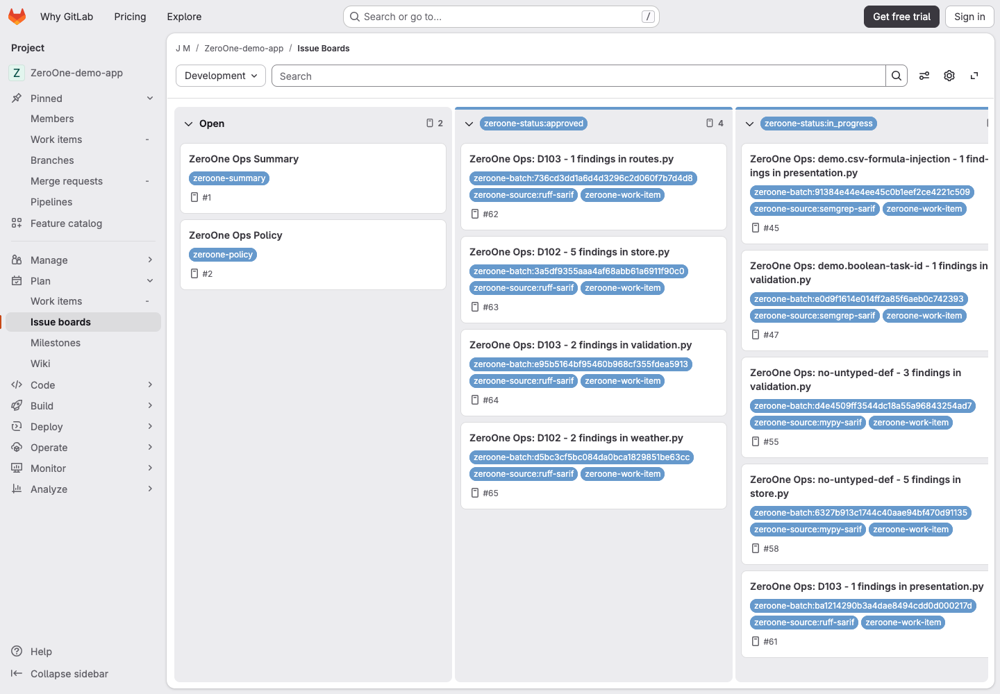

# Getting Started

Install ZeroOne Ops in the repository whose findings and changes it will manage.
Choose the templates for that repository's provider; use the files from your
installed release tag rather than assuming `main` matches your image.

## See It In Action

Explore the [GitLab demo issue board](https://gitlab.com/j.n.r.melger/zeroone-test-app/-/boards#/) to
see how findings, policy, and remediation work appear in a real repository.
The demo contains intentionally seeded findings and is used for acceptance
testing. Issues, requests, and statuses change over time; it is not a production
work queue or a measure of model accuracy. Use it as a read-only reference.

Snapshot captured on 2026-10-31 in a signed-out browser. Select the image to
view it at full size; the live board may now look different.

### Read The Board

| Surface | What to inspect |
| --- | --- |
| Open | Policy and operational-summary issues can appear here; not every open issue is remediation work. |
| `zeroone-status:approved` | Work queued for remediation, subject to current eligibility and execution checks. |
| `zeroone-status:in_progress` | Work that has started, including linked requests awaiting review or merge. |
| Blocked or review-feedback work | Read the issue's failure evidence and next action before considering a supported requeue. |

The board is a navigation view, not a separate authority. Labels are indexes;
the issue's persisted machine state and next-action guidance govern the workflow.
Moving a card or changing a label is not a substitute for an operator command.

### Follow A Batch Into Its Request

Open [example work item #58](https://gitlab.com/j.n.r.melger/zeroone-test-app/-/work_items/58)
and its linked [merge request !25](https://gitlab.com/j.n.r.melger/zeroone-test-app/-/merge_requests/25).
This example groups five MyPy findings in one file into one work item and request.

1. Inspect the frozen members, latest observations, and recorded attempt targets on the issue.
2. Follow the linked request to inspect the diff, validation evidence where available, and review discussion.
3. Read **Change Rationale** as a model-provided explanation, not independent verification.
4. Follow the issue's next action. Where supported, `/zeroone remediation requeue` belongs on the work-item issue, not the MR.

Do not infer that every targeted finding is scanner-verified as resolved merely
because a request exists or was merged. See the [workflow guide](workflows.md)
for execution, observation, and lifecycle boundaries.

## GitHub

Start with the [GitHub control-plane setup](runbook.md#github-control-plane-setup)
and [review workflow example](runbook.md#github-review-workflow-example).
The copyable
[operations](https://github.com/JustinMelger/ZeroOne-ops/blob/main/examples/github-operations.yml),
[review](https://github.com/JustinMelger/ZeroOne-ops/blob/main/examples/github-review.yml),
and [configuration](https://github.com/JustinMelger/ZeroOne-ops/blob/main/examples/.zeroone-ops.github.json)
templates are maintained in the repository.

## GitLab

Follow the [recommended GitLab CI setup](runbook.md#recommended-gitlab-ci-setup).
Use the supported
[CI template](https://github.com/JustinMelger/ZeroOne-ops/blob/main/examples/.gitlab-ci.example.yml)
and [configuration example](https://github.com/JustinMelger/ZeroOne-ops/blob/main/examples/.zeroone-ops.json).
The repository owns scanner production and optional MyPy-to-SARIF conversion.

## Before Enabling Schedules

Configure the [required variables](runbook.md#required-ci-variables) and
[least-privilege token permissions](runbook.md#required-token-permissions).
Read the [execution trust model](runbook.md#execution-trust-model): setup and
validation commands are executable CI policy, not passive scanner data.

Run the [remediation smoke test](runbook.md#smoke-test-recipe) and
[review smoke test](runbook.md#review-smoke-test-recipe) manually before enabling
recurring execution. Existing pre-v1 installations must first follow the
[migration guide](migration-v1.md).
